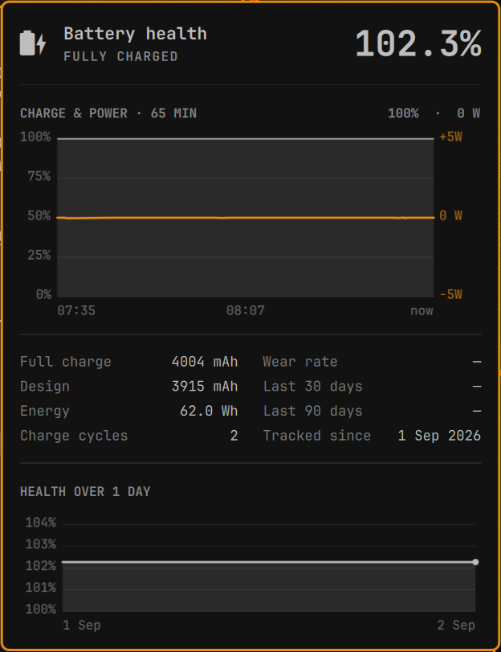

# Battery Health

An Omarchy bar widget for battery telemetry over time.  It tracks two things and keeps the history for both:

- **Charge and power** — the charge level and how fast energy is going in or out, sampled over the past week.  This is what the bar shows and what the panel leads with.
- **Capacity retention** — how much the pack can still hold compared to the day it left the factory.  `charge_full` divided by `charge_full_design`.  A pack that still holds everything it was rated for reads 100%; one that has lost a fifth reads 80%, the figure conventionally treated as end of useful life.

The two move on completely different timescales, which is why they are stored differently.  Charge and power change by the minute and are sampled on a timer and on every UPower event.  Retention only moves when the battery firmware recalibrates — weeks apart — so it is stored as a change-point series that records *when* it moved rather than a reading per day.

Retention is what the widget is named for, but it is also the number you cannot see for weeks on a new battery.  Charge and power give the panel something honest to show from the first hour.



## Install

```bash
make install    # symlinks this checkout into ~/.config/omarchy/plugins/ and rescans
make enable     # adds the widget to the bar
```

`make uninstall` reverses both.  The plugin only ever reads `/sys/class/power_supply` and writes its own history file; it needs no root, no daemon, and no systemd unit.

## The main graph

Charge and power share one time axis over the past week.

**Charge** is the filled area on a fixed 0-100% scale — fixed, not fitted, so the height of the curve means the same thing every time you open the panel.

**Power** is the line on top, on its own symmetric scale arranged so **zero watts lands exactly on the charge axis' 50% line**.  Above that line the pack is taking charge, below it the pack is giving it up, and the distance from the line is how fast.  The axis bound is the same in both directions, so charging and discharging are drawn to one scale and are directly comparable.

Watts come from `power_now` where the driver exposes it, and otherwise from `voltage_now × current_now`. sysfs reports a magnitude and leaves the direction to `status`, so the sign is taken from there — a few drivers do sign `current_now`, which is why the magnitude is taken absolute first rather than trusted.

### Packs that report no rate at all

`power_now` and `current_now` are both optional, and a driver may publish the file and still fail every read — several HP and older ACPI packs return `ENODEV` forever, because the embedded controller leaves the `_BST` rate field at "unknown".  On those machines there is no rate to read, so one is worked out instead, from how far `charge_now` moved between two samples.

This is a real number rather than an estimate of one — it is exactly the energy that left or entered the pack, over exactly the time it took — but it is an **average over a half-hour window rather than an instant**, and it is measured against the oldest sample still inside that window.  The window has to be that wide because the counter is coarse: this HP pack moves `charge_now` in 32 mAh steps, which on a 12 V pack is 0.39 Wh arriving all at once.  Spread over ten minutes that single step is 2.3 W of pure quantisation; spread over half an hour it is 0.8 W, which is honest enough to draw.

What that costs is immediacy: closing something heavy shows up over the following half hour rather than at once.  On a graph a week wide it reads as smoothing rather than lag, and it beats a curve whose teeth belong to the counter rather than to the battery.

Three things make the derivation stand down and report nothing rather than guess.  A span shorter than a minute, where the counter's step is the entire answer.  A span crossing a plug-in or unplug, which has no single rate to average over.  And a span longer than the window — which is also what makes suspend safe, since after a resume the newest sample is hours old and no draw is invented out of the time the machine was asleep.  The first reading after a fresh install, a resume, or a state change therefore shows `0 W` until a second sample exists to measure against.

Machines whose driver does report a rate — the Framework 13 among them — never reach any of this.  The driver's own reading is authoritative and is used untouched.

The axis is **a week wide, but never wider than the data**: with three hours of history it draws three hours across the full frame, rather than a hairline against six empty days.  The header states the span actually drawn.

## What it shows

| Field | Meaning |
|---|---|
| Health % | `charge_full / charge_full_design`. Above 100% is normal on a new pack — firmware often rates conservatively, and the value is deliberately not clamped. |
| Full charge | What the pack holds today, in the unit sysfs reports (mAh or Wh). |
| Design | What it was rated for when new. |
| Energy | Watt-hours. Derived from mAh × design voltage when the battery reports charge rather than energy. |
| Charge cycles | `cycle_count`, when the firmware exposes it. |
| Wear rate | Least-squares slope through the health curve, in percent per month. |
| Last 30 / 90 days | Change against the reading closest to that boundary. |
| Reaches 80% | Linear extrapolation of the wear rate down to the end-of-life line. |

Several of these deliberately show `—` rather than a number:

- **Wear rate** needs at least four samples spanning two weeks.  A slope fitted to less than that describes sysfs rounding, not the battery.
- **Last 30 / 90 days** appear only once the history actually reaches back that far, instead of quietly comparing against the oldest sample on hand.
- **Reaches 80%** appears only for a battery that is actually declining.  A flat or improving one would need a fabricated slope to produce a date, and a pack already below 80% has nothing left to project.

The 80% line is drawn on the health graph only when it is in view — a healthy battery is not permanently reminded of its mortality.

One thing worth being blunt about: health is the battery controller's own self-report.  `charge_full` is the firmware's estimate of present full capacity, and it only updates when the firmware recalibrates — usually after a full charge.  This plugin measures nothing itself; it does not integrate the watt-hours from the charge and power series to derive capacity independently.  So health here means *what the pack's controller currently claims it can hold, against its nameplate*.  It moves in steps rather than smoothly, and a pack held at a charge limit that never recalibrates can read optimistically.

## The bar readout

Text only, no glyph.  This widget normally sits right next to `omarchy.power`, which already carries a battery icon, and two battery icons in a row is just noise.

It shows the **live charge level** by default — that is the number worth glancing at minute to minute.  The slow numbers this widget actually collects are one right-click away, and all of them are in the tooltip:

| Mode | Shows |
|---|---|
| `charge` (default) | Live charge level, e.g. `63%` |
| `health` | Capacity retention, e.g. `102%` |
| `cycles` | Charge cycles, e.g. `2 cyc` |

## Interactions

| Where | Action |
|---|---|
| Bar widget, left | Open the panel |
| Bar widget, right | Cycle the readout: charge % → health % → cycles |
| Bar widget, middle | Sample now |
| Health graph, hover | Reading and date for the nearest sample |
| Panel, `Esc` | Close · `Tab` moves to the next panel |

Over IPC:

```bash
omarchy-shell io.github.mvaled.battery-health toggle
omarchy-shell io.github.mvaled.battery-health refresh
omarchy-shell io.github.mvaled.battery-health cycleDisplay
```

## Settings

Set them with `omarchy bar set io.github.mvaled.battery-health <key> <value> --json`, or inline on the widget's entry in `~/.config/omarchy/shell.json`.

| Key | Default | Meaning |
|---|---|---|
| `activeIntervalSec` | `600` | Polling interval while charging or discharging. |
| `idleIntervalSec` | `1800` | Polling interval while idle. Nothing moves, so it backs off. |
| `chargeWindowDays` | `7` | How far back the charge and power graph reaches, and how long those samples are kept. |
| `historyDays` | `730` | How far back health samples are kept. |
| `displayMode` | `charge` | Bar readout: `charge`, `health`, or `cycles`. Text only — see above. |
| `battery` | `""` | Pin a specific `/sys/class/power_supply` entry. Empty picks the first battery reporting a design capacity. |

## How it samples

Sampling is **event-driven first, polled second**.

UPower announces every plug-in, unplug and charge-state change, and each one takes a reading immediately — so the exact moment a charge or discharge begins lands on the graph rather than being rounded to the next poll.  Crossing a whole percent counts too, which on a battery that drains in well under a day is frequent enough to draw a proper curve on its own.

Between events a timer fills in, and its cadence follows the charge state:

| State | Default interval |
|---|---|
| Charging or discharging | 10 minutes |
| Idle, full, or held at a charge limit | 30 minutes |

Nothing moves in the idle state, so polling backs off rather than burning wakeups on a reading that cannot have changed.  Event-driven samples take a 30-second floor so a fast charger crossing a percent every half minute cannot spawn a probe per percent; an explicit refresh (middle-click, IPC) bypasses it.

## How it stores history

One JSON file, `~/.local/state/io.github.mvaled.battery-health/history.json`:

```json
{
  "v": 1,
  "battery": "BAT1",
  "unit": "Ah",
  "health": [{"t": 1788300000, "full": 4004000, "design": 3915000, "cyc": 2}],
  "charge": [{"t": 1788324982, "p": 63, "s": -1, "w": -14.2, "n": 2523000}]
}
```

`health` is a **change-point series**.  `charge_full` only moves when the firmware recalibrates, so storing every poll would be thousands of identical rows — but bucketing to a day would throw away *when* the capacity actually changed, which is the interesting part.  So a row is written when a value differs from the last one on record, plus a heartbeat every six hours to prove a quiet stretch was observed rather than unmonitored.  Timestamps are exact.

`charge` holds every sample inside the graph window — a week by default, which is what lets the axis reach back that far.  `s` is the charge direction (`1` charging, `0` idle, `-1` discharging), `w` is the signed draw in watts, and `n` is the raw `charge_now` or `energy_now` reading behind `p`, in the micro-unit sysfs used.  `n` is what lets a pack with no rate attribute derive `w` at all; on a pack that reports a rate it is simply along for the ride.  Rows written before `n` existed are read back with `n: 0`, which the derivation skips rather than mistaking for an empty pack.  A heavy week lands in the low thousands of samples; the cap leaves room above that and still keeps the file well under a megabyte.

Both arrays are capped inside `Model.js` independently of the retention settings, so a corrupt or hand-grown file cannot make a repaint unbounded.  At the maximum retention the file is a few hundred kilobytes.

Swapping the battery pack resets the history.  The old curve describes hardware that is no longer in the machine, and keeping it would draw a cliff that reads as sudden failure.

`make state` prints a summary of what has been collected so far; `make reset` deletes it.

## Why it stays cheap

A bar widget lives inside the same process as the rest of your desktop, so this one is built to be boring:

- Exactly one `Process`, never re-armed while it is still running.
- Polling that follows the charge state and backs off to half-hourly when the battery is idle, instead of a fixed fast interval.
- A 30-second floor on event-driven samples, so a burst of UPower signals cannot turn into a burst of processes.
- Canvases repaint only while the panel is open.
- Every array has a hard ceiling, so no input makes a redraw unbounded.
- All parsing, retention and statistics live in `Model.js` with no QML imports, and are covered by tests that run without a shell or a battery.

## Layout

| File | What it is |
|---|---|
| `manifest.json` | Plugin declaration, settings defaults and schema |
| `Panel.qml` | Bar button, popup, canvas rendering, Quickshell wiring |
| `Model.js` | Probe parsing, history retention, statistics, graph geometry |
| `probe.sh` | Reads one battery out of sysfs, emits TSV |
| `tests/model.test.js` | `Model.js` under node |
| `tests/probe.test.sh` | `probe.sh` against synthetic sysfs trees |

## Development

```bash
make check    # lint + both suites
make reload   # make the running shell re-read the plugin after an edit
make sample   # run the probe against this machine
```

`make reload` runs `omarchy-shell shell rescanPlugins`, which re-reads the plugin registry but does **not** re-instantiate a bar widget that is already mounted — edited QML keeps running as the old version.  Use `omarchy restart shell` to actually pick up code changes.  `make reload` is still the right call after adding or removing a plugin.

## Requirements

Omarchy 4.x with the Quickshell-based `omarchy-shell`, and a battery that exposes `charge_full_design` or `energy_full_design` in `/sys/class/power_supply`.  Machines without one show "No battery detected" rather than a broken widget.

A rate attribute is **not** required.  `power_now` and `current_now` are used where the driver offers them; where it offers neither — or publishes the file and fails the read, as several HP and older ACPI packs do — the draw is [derived from `charge_now` over time](#packs-that-report-no-rate-at-all) instead.

## Licence

MIT.  See [LICENSE](LICENSE).
